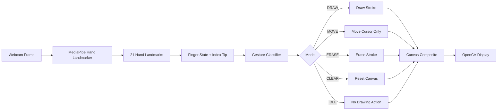

# Air Writer — Real-Time Hand Gesture Drawing

[](https://github.com/alaamadii/air-writer/actions/workflows/ci.yml)

Air Writer is a real-time Computer Vision application that turns hand gestures into drawing actions on a virtual canvas. It uses MediaPipe Hand Landmarker to detect hand landmarks from a webcam feed, derives finger states, classifies gestures into application modes, and renders drawing, movement, erasing, and canvas-clearing interactions with OpenCV.

**Portfolio focus:** Computer Vision · gesture recognition · real-time interaction · testable application logic · CI

## Engineering Highlights

- Uses MediaPipe Tasks / Hand Landmarker for local real-time hand detection.
- Extracts the index-finger tip as the virtual pen position.
- Derives five-finger up/down state with handedness-aware thumb logic.
- Separates gesture classification from camera/rendering code so gesture behavior can be unit tested without a webcam.
- Supports explicit `DRAW`, `MOVE`, `ERASE`, `CLEAR`, and `IDLE` modes.
- Keeps drawing state on a separate NumPy canvas and composites it over the live camera frame.
- Handles camera startup failures explicitly and releases both camera and MediaPipe resources on exit.
- Runs linting, formatting checks, source compilation, and deterministic unit tests in GitHub Actions.

## Vision-to-Drawing Pipeline



## Implemented Gestures

| Gesture state | Application mode | Behavior |
| --- | --- | --- |
| Index up, middle down | Draw | Draws a continuous stroke using the index fingertip |
| Index + middle up, ring down | Move | Moves the cursor without drawing |
| Index + middle + ring up, pinky down | Erase | Erases along the index-finger path |
| All five fingers up | Clear | Clears the complete drawing canvas |
| Anything else / invalid state | Idle | No drawing action |

Keyboard shortcuts:

- `C` — clear the canvas
- `Q` — quit

## Tech Stack

- Python 3.10+
- OpenCV
- MediaPipe Tasks / Hand Landmarker
- NumPy
- Python `unittest`
- Ruff
- GitHub Actions

## Project Structure

```text
air-writer/
├── main.py                     # Camera loop, canvas updates, and display
├── hand_tracker.py             # MediaPipe detection and finger-state extraction
├── gesture_logic.py            # Pure gesture classification logic
├── config.py                   # Camera, brush, eraser, and confidence settings
├── hand_landmarker.task        # MediaPipe hand-landmark model asset
├── requirements.txt
├── pyproject.toml              # Ruff configuration
├── tests/
│   └── test_gesture_logic.py   # Deterministic gesture-mode tests
└── .github/workflows/ci.yml    # Automated quality checks
```

## Getting Started

### Requirements

- Python 3.10 or newer
- A working webcam
- Desktop environment with OpenCV window support

### Installation

```bash
git clone https://github.com/alaamadii/air-writer.git
cd air-writer
python -m venv .venv
```

Activate the environment:

```powershell
# Windows PowerShell
.\.venv\Scripts\Activate.ps1
```

```bash
# macOS / Linux
source .venv/bin/activate
```

Install dependencies:

```bash
python -m pip install --upgrade pip
pip install -r requirements.txt
```

### Run

```bash
python main.py
```

Allow camera access if your operating system asks for permission.

## How Gesture Recognition Works

`HandTracker` runs MediaPipe Hand Landmarker on each frame. The application uses landmark 8 as the index-finger tip and determines whether each finger is raised. The thumb uses handedness-aware horizontal landmark comparison, while the index, middle, ring, and pinky use vertical tip-to-joint comparisons.

The resulting five-value finger state is passed to `classify_gesture()`, which is intentionally independent from OpenCV and MediaPipe. This keeps the interaction rules simple to reason about and allows the gesture mapping to be tested in CI without requiring a physical webcam.

## Drawing Model

The application maintains a NumPy canvas with the same dimensions as the camera frame. Drawing and erasing modify this canvas rather than the camera image directly. Each frame then combines the live video with the non-black pixels of the canvas to produce the displayed result.

The previous fingertip position is reset when no valid hand is detected, preventing a long accidental line when tracking resumes at a different location.

## Configuration

`config.py` exposes the main runtime parameters:

- Camera index
- Capture width and height
- Brush color and thickness
- Eraser thickness
- MediaPipe detection confidence
- MediaPipe hand-presence / tracking confidence

OpenCV colors use BGR ordering rather than RGB.

## Automated Quality Checks

GitHub Actions validates the repository on pushes and pull requests with:

```bash
ruff check .
ruff format --check .
python -m compileall -q .
python -m unittest discover -s tests -v
```

The current tests focus on deterministic gesture classification: draw, move, erase, clear, idle, and invalid finger-state inputs. Camera and physical hand-tracking behavior are not suitable for deterministic CI without recorded-media fixtures or hardware-in-the-loop testing.

## Privacy

Camera frames are processed locally by this application. The project does not upload webcam frames or save them by default.

## Current Limitations

- Recognition quality depends on lighting, camera angle, hand visibility, and MediaPipe confidence.
- Finger-state rules are heuristic rather than a trained custom gesture classifier.
- The current application tracks one hand.
- There is no motion smoothing, undo/redo, saved drawing history, OCR, or virtual toolbar.
- Automated tests validate deterministic interaction logic but do not validate physical webcam behavior.

These are explicit scope limits rather than claimed production features.

## Possible Future Improvements

- Motion smoothing for steadier strokes
- Recorded-video tests for the vision pipeline
- Configurable brush colors and sizes in the UI
- Undo/redo and image export
- Multi-hand interaction
- Optional handwriting/OCR experiments

## Author

**Alaa Madi** — Software Engineering / Machine Learning & Computer Vision
